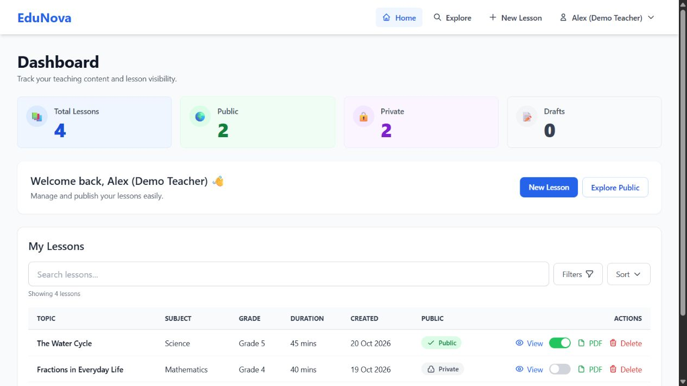
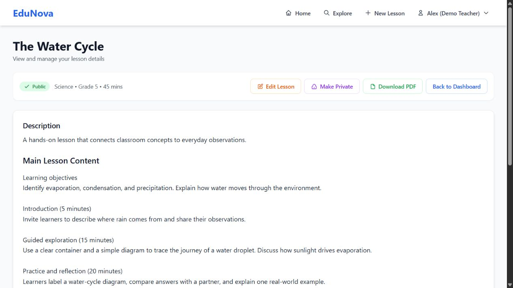
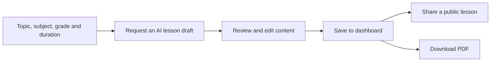
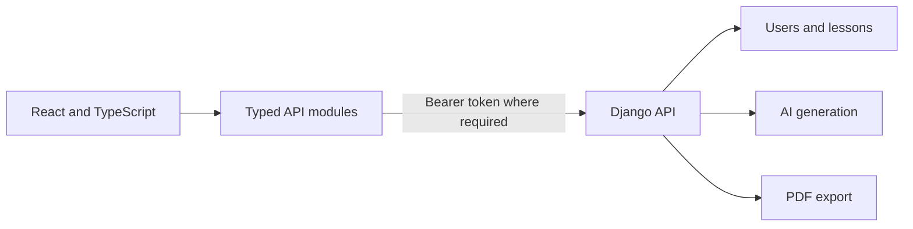

<div align="center">

# EduNova

### From a lesson idea to an editable teaching resource

An AI-assisted workspace for generating, organizing, sharing, and exporting lesson plans.


[Explore EduNova](https://edu-nova-zeta.vercel.app/) · [Backend repository](https://github.com/VanshMehta1234/EduNova-BE) · [Developer portfolio](https://www.builtbyvansh.com/)

</div>

---

EduNova turns a topic, subject, grade level, and lesson duration into a structured draft that a teacher can review and edit. The application brings generation, lesson management, public discovery, and PDF export into one workflow.

**This repository contains the React frontend.** AI generation, authentication, persistence, and PDF generation are provided by the companion Django API. The public landing page and lesson explorer are available without signing in; creating and managing lessons requires an account and a working backend.

## Screenshots

Actual application screens captured locally with fictional teacher and lesson records. Backend responses are simulated for this demo.

### Lesson management dashboard

Lesson totals, public/private visibility, search, filters, and quick access to lesson actions.



### Lesson workspace

A saved lesson with teaching content and controls for editing, visibility, and PDF export.



## The product workflow



| Capability | Included in the interface |
| --- | --- |
| **Lesson drafting** | Topic-based requests with subject, grade, and duration controls. |
| **Content editing** | Editable description, lesson content, activities, questions, summary, images, and video links. |
| **Personal dashboard** | Saved lessons, search/filter controls, editing, and deletion. |
| **Public discovery** | Browse shared lessons and open a lesson by its public slug. |
| **Sharing and export** | Public/private visibility controls and authenticated PDF download. |
| **Account flows** | Registration, login, session restoration, protected pages, and API error feedback. |

AI output is an editable draft; subject accuracy and classroom suitability still require teacher review.

## Architecture



The frontend uses React 19, React Router 7, Tailwind CSS 3, and Vite 7. API modules describe lesson and authentication payloads; `src/services/api.ts` centralizes requests and error handling. JWTs and restored user state are stored in browser local storage.

## Run locally

Use **Node.js 20.19+ or 22.12+**, matching the engine range of the locked Vite package, and npm.

```bash
git clone https://github.com/VanshMehta1234/EduNova.git
cd EduNova
npm ci
```

Create `.env` in the repository root:

```dotenv
VITE_API_URL=http://localhost:8000/api
```

The value includes `/api`, without a trailing slash. Start the [companion backend](https://github.com/VanshMehta1234/EduNova-BE) using its own setup instructions, and allow the frontend origin in its CORS configuration.

```bash
npm run dev
```

Open the local URL printed by Vite, normally [localhost:5173](http://localhost:5173). No model API key belongs in a `VITE_` variable; model-provider configuration stays in the backend.

### API integration map

All paths below are relative to `VITE_API_URL` and reflect the current frontend source.

| Action | Endpoint |
| --- | --- |
| Register / sign in / restore user | `/auth/register/`, `/auth/login/`, `/auth/me/` |
| Generate a lesson draft | `POST /lessons/generate/` |
| List / create lessons | `GET` / `POST /lessons/` |
| Read / edit / delete a lesson | `GET` / `PATCH` / `DELETE /lessons/{id}/` |
| Change visibility | `PATCH /lessons/{id}/visibility/` |
| Browse / read public lessons | `/lessons/public/`, `/lessons/public/{slug}/` |
| Download a lesson PDF | `GET /lessons/{id}/pdf/` |

## Code map

```text
src/
  api/          Typed auth and lesson endpoints
  services/     Shared HTTP client and API error handling
  contexts/     Authentication and restored user state
  components/   Layout, navigation and route protection
  pages/        Landing, dashboard, lesson editing and discovery
  constants/    Browser storage keys
public/         Landing imagery and static assets
vercel.json     SPA routing rules
```

## Build and delivery

| Command | Purpose |
| --- | --- |
| `npm run dev` | Start Vite locally. |
| `npm run lint` | Run ESLint. |
| `npm run build` | Run the TypeScript project build and produce `dist/`. |
| `npm run preview` | Preview the built frontend locally. |

For static hosting, use `npm run build`, publish `dist/`, and set `VITE_API_URL` before building. Preserve SPA fallback routing so direct lesson and dashboard URLs load correctly. The checked-in `vercel.json` contains the Vercel rewrite configuration.

### Handover checks

- Register and sign in against the intended backend, then confirm session restoration and logout.
- Generate a draft, edit it, save it, and verify it appears in the dashboard.
- Toggle a lesson's visibility and confirm its public URL behaves as intended.
- Export a PDF and check the file contents.
- Confirm expired or invalid tokens receive an appropriate backend response. The frontend stores a refresh token, but its HTTP client does not implement automatic token refresh.

These are review steps, not a claim that an automated end-to-end test suite is included. There is no test script in the current `package.json`.

---

Built by **Vansh Mehta** · [Portfolio](https://www.builtbyvansh.com/) · [Discuss an AI or SaaS project](mailto:founder@builtbyvansh.com)
